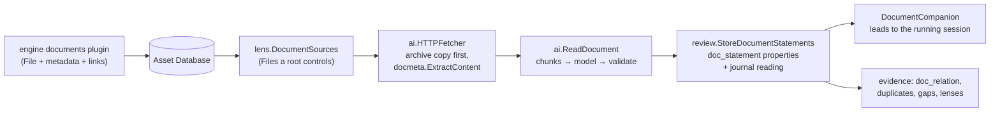

# Documents and the document model: implementation

The user page is `docs/ai/documents.md` in the docs repository. This page is
for contributors: how documents are read, what is stored, how leads work,
and how findings count as evidence.

## Pipeline



| Piece | Where |
| --- | --- |
| Settings (`options.ai.documents`) | `config/ai.go` (`DocumentModelSettings`, `Validate`) |
| Model client | `internal/ai/models.go` (`DocumentModel`) |
| Text extraction | `internal/docmeta/content.go` (`ExtractContent`) |
| Fetching | `internal/ai/document_fetch.go` |
| Reading and validation | `internal/ai/documents.go`, `document_vocabulary.go` |
| Runs (on demand and in the companion) | `internal/ai/document_runs.go` (`ReadDocuments`) |
| Companion, leads, budget | `internal/ai/document_companion.go`, `document_leads.go`, `document_budget.go` |
| Storage, journal, settlement | `internal/review/document_statements.go`, `document_leads.go` |
| Document sources and lens | `internal/lens/document_sources.go`, `documents.go` |
| Evidence | `internal/lens/document_relations.go`, `document_evidence.go`, `document_lens_evidence.go` |
| Data | `internal/semantics/statement_predicates.json`, `document_signals.json`, `document_names.json` |

## How much the engine collects in one run

The engine's documents plugin (`engine/plugins/documents`) bounds each run with
the limits in `internal/semantics/documents.json`:

- `max_per_run` (250): documents fetched for one registered domain in one run
  (`admit`, counted across its hosts). A document past the limit is not marked
  as tried, so a later run fetches it.
- A document named inside another document read in the same run is left for a
  later run too (`ledFromDocument`), so documents don't lead to documents
  within a run.
- `max_url_leads` (20): in-scope URLs one document hands the pipeline as leads.
  Every URL it names is still stored and linked from the File by `contains`;
  catalogs and link lists otherwise handed runs hundreds of pages each.
- The transformation TTL in the config (`support.TTLStartTime(cfg, "URL",
  "File", "Documents")`): `URL->Documents` when present, otherwise `URL->File`
  (30 days in the shipped configs), otherwise `URL->ALL`. A URL with a File
  stored within it is not fetched again, so each run reaches documents not yet
  read. Users set how often documents are refreshed there.
- Carry-over (`backlog`, the `Documents-Backlog-Handler` on FQDN events): when an
  in-scope host comes up, its URLs (`URL --domain--> FQDN`) with a document
  extension, no File and no attempt within the `URL->File` ttl are handed to
  the pipeline again, up to `max_per_run`. Without it, a document left by an
  earlier run would only be fetched if something named it again.

## Nothing stored but findings

The database keeps no document content. `lens.DocumentSources` gives each
File's URL, the archive copy the engine read (`RetrievedFrom`), the media type,
the stored SHA-256 (the `file_sha256` fingerprint Identifier) and the number of
statements already stored. `HTTPFetcher` fetches the archive copy when there is
one, otherwise the URL, extracts text and links in memory, and hashes the bytes.

Each version is read once: `Journal.ReadVersions` records every SHA-256 read,
including readings that found nothing. A File whose version was read is
skipped, and so is a fetched document whose new hash was already read. The
`-reread` option undoes the earlier readings (by File and by version) before
reading again. Engines on one database read a version once between them: the
one holding the version's `doc:<sha256>` lease reads it, renewing the lease as
it goes, and checks the journal again first in case another just finished it;
the others count the version as remaining.

## Reading

- **Scanned PDFs:** a PDF with under 200 characters of text (`scanned`) has
  its page pictures read instead: `docmeta.PageImages` returns its image
  streams of at least 600 pixels a side, in order: JPEG, and CCITT fax (group
  3 or 4, what office scanners write for black-and-white pages) wrapped as a
  one-strip TIFF (`faxTIFF`). JBIG2 and JPEG 2000 pages are not read. `HTTPFetcher.Pages` (`ai.DocumentPages`) reads at
  most 64 of them:
  - when the document model sees pictures (`options.ai.documents.vision`; on
    auto, an Anthropic model does, an Ollama model does when `/api/show`
    lists `vision`, an OpenAI-compatible one does not), each page is sent as
    an `llm.Image` with a prompt to write out its text;
  - otherwise, and for a fax page (models take no TIFF), Tesseract
    (`tesseract stdin stdout`) reads the page, when it is installed (the
    Compose images have it); without it such a page is skipped;
  - without either, the document has no text, as before
    (`ErrNoPageReader`).

  The transcription is then read like any text, so quotes are checked
  against it.
- **Text clean-up:** `cleanText` replaces control characters, other than
  newlines and tabs, with spaces. A schema-constrained reply can't copy a raw
  control character into a JSON string, and Ollama fails the request partway
  through.
- **Chunks:** `chunkText` splits the text into `chunk_chars` (default 12000)
  with a 400-character overlap, ending at sentence boundaries where possible.
  `OnChunk` is called after each chunk, and counts as the `chunks_read`
  activity.
- **Reply shape:** each chunk's reply is `{category, assets[], statements[],
  attributes[]}`, generated against the JSON schema built from
  `documentVocabulary()`. The vocabulary covers all OAM asset types, the
  relations OAM allows between them (`GetAssetOutgoingRelations` /
  `GetTransformAssetTypes`), the extra predicates in
  `statement_predicates.json`, and each type's fields.
- **Reply cap:** `max_tokens` (default 4096) is sent as `num_predict`. A reply
  cut off at the cap (`llm.ErrReplyLength`) is incomplete JSON, so that chunk is
  recorded as rejected and reading continues with the next.
- **Validation:** a finding is kept only when all of these hold:
  - the quote is verbatim in the chunk;
  - names and values are written within ±300 characters of the quote (inside
    the quote first, `quoteSite.find`);
  - the value passes its type's check (host name, CIDR, AS number, email,
    E.164 phone, …);
  - the relation is allowed by OAM or the predicate catalog;
  - there is no negation cue in the same sentence;
  - Organization, Person, Product and ProductRelease values are proper names:
    `properName`, which rejects fragments of words split by PDF extraction
    (`fragmented`);
  - a relation's two ends are not one organization by normalized name
    (`sameOrganization`);
  - an Organization or Person value does not name something else
    (`semantics.MisnamedDocumentName`, `document_names.json`): a building or
    a law named as an Organization ("Boyd Hall", "Clery Act"), a course
    named as either ("CS 101"), or a job title named as a Person ("Dean of
    Students").

After every chunk is read, `dropContradictions` rejects the hierarchy
findings (`lens.HierarchyPredicate`: `unit_of`, `subsidiary_of`,
`acquired_by`, `owned_by`) of which two put each of two organizations over
the other.

### Failures

`ReadDocuments` records why a document could not be read
(`DocumentResult.Failure`, counted in `DocumentRun.Failures`):

| Kind | Cause | Retried in the run |
| --- | --- | --- |
| `unsupported` | not a document type the rules read | no |
| `fetch` | HTTP status, network error, timeout, or a custom fetcher's error | once |
| `too_large` | longer than the documents rules' `MaxBytes` | no |
| `extract` | `docmeta.ExtractContent` failed | no |
| `model_timeout` | deadline exceeded or a net timeout on a model request | once |
| `model` | any other model error | once |

The companion keeps each File's failures for the run (`companionRun.failed`)
and passes `Skip`, so a document that will fail again doesn't fill every
pass's batch. Run activity counts them as `document_failures` and
`document_failures_<kind>`.

## Storage

Each kept finding is a `doc_statement` SimpleProperty on the File, holding
JSON:

```json
{"kind": "asset|relation|attribute", "subject": "…", "subject_type": "…",
 "predicate": "…", "object": "…", "object_type": "…", "field": "…",
 "detail": "…", "quote": "…", "sha256": "…", "model": "ollama/qwen3:8b",
 "source": "amass-ai"}
```

A reading is journaled as `doc:<file id>:<time>`, with counts, the version's
hash and the property tag IDs but no document text, so it can be undone
(`UndoDocumentStatements`). `graph.DocumentTextProperties` lists the
properties holding document text; the graph adapter withholds them from other
models unless `share_with_assistants` is set.

## The companion

`ai.DocumentCompanion` implements `collect.Companion` and `collect.Finisher`
for MCP-started runs:

- **Passes:** it runs one every `Interval` (30 s) and once more when the
  engine is done, reading at most `Batch` (3) documents per domain target per
  pass.
- **Long documents:** one reading of one document stops at
  `options.ai.documents.document_timeout` (default 10 minutes) or
  `max_chunks` (default none), whichever comes first, after the part in
  progress (`readLimits`). It is journaled with `through`, the offset of the
  cleaned text where the next part starts (`StorePartialDocumentStatements`);
  `chunkSpans` gives the same parts for the same text, so the next reading
  starts exactly there. A version read only in part is not counted as read
  (`ReadVersions`); `VersionProgress` gives the offset the next reading starts
  at, and the run counts the document as remaining, so the companion's next
  pass continues it while the hold allows, and a later run otherwise.
- **Holding the run open:** the collect manager holds the run open up to
  `HoldLimit` (`options.ai.documents.hold`, default 15 minutes; 0 sets a
  negative `HoldLimit`, which holds no run) while a pass is running or
  documents remain. A model that fails every document is treated as
  unavailable and doesn't hold the run. The companion also times its reading
  (`readTime` over `readDocs`) and stops reporting work pending once the
  documents left, at that pace, would outlast the hold (`outlastsHold`):
  holding on would end the run at the limit with them unread anyway. The next
  run or `read_documents` reads them.
- **Activity:** `documents_read`, `chunks_read`, `statements`,
  `document_failures` (and by kind), `document_errors`, `documents_stale`,
  `leads` and `leads_waiting`.

### Leads

`statementLeads` turns a stored finding into leads (both ends of a relation).
`leadFor(type, value, region)` builds the asset for each collectable type:

| Type | Lead |
| --- | --- |
| FQDN | lower-cased, trailing dot removed, valid domain name |
| IPAddress, Netblock (masked), AutonomousSystem | parsed |
| StreetAddress | passes `checkValue` |
| Phone | parsed in `region` (`docmeta.PhoneRegion` of the document's host: the ccTLD's country, `.uk` → GB, otherwise US); `Raw` and `E164` both hold E.164 |
| Identifier | email addresses only |
| URL | http(s) with a host, none of `<>"'` backtick `{}|` or whitespace |
| Organization | `properName` and not `genericUnit` |

- **Generic units:** `genericUnit` treats a unit prefix ("office of",
  "department of", "center for", …) plus at most three words as the
  publisher's own unit, unless a public-body marker ("federal", "state",
  "county", "city of", …) appears.
- **Generic names:** an Organization whose name has no entity form word and
  only generic office or service words ("Counseling", "Rapid Response";
  `semantics.GenericOrganizationName`, catalog `document_leads.json`) is a
  finding only: the registries match such a name to unrelated bodies.
- **Known assets:** a lead the database already holds (`knownLead`, an exact
  `ResolveAsset` or `ResolveOrganizations`) is not submitted. Each name is
  submitted once per run (`seen`).

**Ordering (anchors):**
- Any lead but an Organization is anchored.
- An Organization is anchored when the same document relates it to an anchor
  type: FQDN, URL, IPAddress, Netblock, AutonomousSystem, StreetAddress, Phone
  or Identifier (`anchoredOrganizations`).
- Only anchored leads are queued. An organization named alone is a finding
  only: it is not marked `seen`, so a later document that anchors it queues
  it. (Real runs: 14 organization-only leads went out over two runs on one college,
  none confirmed, and their failures tripped the confirmation-rate gate,
  holding back the anchored leads behind them.)
- Leads are submitted oldest first.

**Stale documents:** `lens.DocumentSource.Dated` is the newest parseable
`doc_modified`/`doc_created` (RFC 3339, `2006-01-02T15:04:05` or
`2006-01-02`, after `docmeta.NormalizeDate`, which also reads a PDF date
stored without its `D:` prefix; years before 1990 are tool defaults and
ignored), and `Stale`
is set when it is older than `lens.DocumentStaleAge` (5 years). A stale
document is read (after the current ones: `ReadDocuments` sorts stale last)
and its findings stored, but:
- the companion gives no leads from it (`DocumentResult.Stale`; counted as
  `documents_stale`);
- `lens.staleFinding` drops its findings from `FindDocumentRelations`,
  `documentFindings` (duplicate and ownership signals) and
  `rootDocumentFindings` (vendors, affiliation), except
  `docFormerPredicates` (former names, mergers), which stay true.

**Budget (`allowance`):**
- It starts at `InitialDocumentLeads` (50), plus `leadsPerConfirmation` (2)
  for each lead the engine confirmed (`LeadConfirmed`, below). An unconfirmed
  lead is checked again at most every `leadRecheckInterval` (1 minute), since
  a check walks the relations around it.
- Once `leadRateSample` (10) leads have been checked (a lead counts as checked
  after `leadCheckAge`, 2 minutes), new leads wait while fewer than
  `leadConfirmationRate` (half) of them are confirmed.
- The ceiling is max(50, completed work items / `leadRunShare` (10)), lowered
  to `max_leads` when that's positive; -1 submits nothing.

Each submitted lead is tagged `amass-ai` with a `doc_lead` property
(document URL, predicate, model, run) and journaled as
`doclead:<run>:<entity>` (`RecordDocumentLead`).

### Settlement

`Finish` calls `review.SettleDocumentLeads`:

- **Confirmed** (`LeadConfirmed`): the engine tied the lead to the run's
  targets (`review.LeadTargets`, from the plan's scope value and `also`
  entries: domains, address ranges, AS numbers). The lead is a target asset
  (an FQDN at or under a target domain, an address or netblock inside a target
  range, a target AS) with at least one relation, or a target asset is within
  `tieDepth` (4) relations of it (`tiedToTargets`; up to `tieMaxSeen` (300)
  entities). An asset with more than `tieMaxEdges` (100) relations is checked
  but not walked through, and FundsTransfers are not walked through, since a
  transfer joins payer and recipient and would tie organizations paid by the
  same agency. Linking the lead to anything at all is not enough: an
  organization named in passing collects records of its own (its funding, its
  registrations). Without targets the old rule applies: any relation, or
  another source's tag. When confirmed:
  - the `doc_lead` property is copied onto each relation that touches the
    lead;
  - the footprint is recorded (`leadFootprint`): relations created after
    submission, within 3 hops, up to 500 entities, the first 100 IDs kept;
  - the lead is shown by `amass review applied` and listed asset by asset by
    `amass review lead`.
- **Otherwise:** the lead is retracted as expired (reviewer
  `DocumentLeadExpiredReviewer`). Its tags are removed, and the asset too
  when nothing links to it.

`Finish` then records the run's `doc_relation` proposals (below).

## Findings as evidence

Every document signal has kind `document` and strength `supporting`. The
weights are in `document_signals.json`:

| | |
| --- | --- |
| Base | 0.15 |
| First-party bonus | +0.05: the document is on one of the subject's own domains |
| Corroboration bonus | +0.05: two or more distinct versions (SHA-256) state it |
| Cap | 0.25; loading rejects a cap at or above 0.3, below every strong signal (0.35) |
| Age | full weight while the newest document stating it is at most `current_years` (2) old, then falling in a straight line to `aged_factor` (0.5) of it at five years (`documentFreshness`); an undated document, and a former name or merger, keep their weight |

`DocumentWeight(firstParty, versions, dated)` computes it, where `dated` is
the newest date of the documents stating the finding (`DocumentSource.Dated`,
`docFinding.dated`). `GapSignal.Weight`
carries it into `scoreSignals`, which uses the smaller of it and the catalog
weight. Names resolve exactly: `docFold` folds case and whitespace only, and
an ambiguous match gives nothing.

### Relation proposals (`doc_relation`)

`lens.FindDocumentRelations` reads a root's own documents (all first-party)
and proposes, through the relation framework:

| Predicates | Relation |
| --- | --- |
| `unit_of` | parent `org_unit` unit |
| `subsidiary_of`, `acquired_by`, `owned_by` (Organization) | parent `subsidiary` child |
| `funded_by` | org `funding_source` funder |
| `holds_role` | org `member` person |
| `located_at`, `headquartered_at` (stored address only) | org `street_address` / `hq_address` address |

- **Skipped pairs:** pairs already linked by the label, or for organizations
  by `org_unit` or `subsidiary` in either direction.
- **Contradictions** (`document_contradictions.go`), for `org_unit` and
  `subsidiary`:
  - the proposed child is already stored above the proposed parent
    (`ancestorsOf`, up to 8 levels);
  - for `org_unit`, the child is already stored as a unit of an organization
    that is neither above nor below the proposed parent;
  - the documents state the pair both ways (`dropReversed`), in one document
    or across two: neither is proposed.
- **Units of the publisher:** the prompt has the model write
  `lens.DocumentPublisher` (`PUBLISHER`) as the object of a `unit_of` finding
  for an office, department, campus or program of the organization that runs
  the document's site. `validatePublisherUnit` allows the placeholder only
  there: the unit's name must be written where it is quoted and not negated,
  and the stored `detail` says it is implied by the publisher.
  `documentSourcesOf` returns the publisher (the root organization, or the
  root domain's single owner) and `docRelations.resolve` maps the placeholder
  to it. The placeholder is never a lead (`statementLeads`) and never a name
  in `documentFindings`.
- **New units:** for an `org_unit` finding whose parent is the publisher,
  a unit that is not stored, or is stored only as another organization's
  unit or subsidiary (`unitOfOther`), becomes a candidate with
  `RelationCandidate.NewTo` (`lens.NewAsset`): an Organization whose
  `unique_id` is `lens.UnitKey(parent, name)` (`<parent key> / <name>`). A
  unit already stored under that key is linked instead. The proposal ID uses
  `new:<type>:<key>` as the destination. `review.ApplyRelation` creates the
  asset (when the store implements `CreateAsset`) and records `CreatedID`;
  `RetractRelation` deletes the edge and that asset.
- **Org-group lens:** `lens.DocumentUnits` lists the units the subject's own,
  current documents name (`unit_of` with the placeholder or the subject's
  exact name or legal name), marking those stored as its `org_unit`s; the CLI
  and the agent set `GroupReport.DocumentUnits` and `FormatGroupReport`
  prints them.
- **Duplicates:** two organizations that are each a unit or subsidiary of a
  different parent get `parent_or_subsidiary` (negative, `differentParents`),
  so offices of one name at two organizations aren't proposed as one.
- **Confidence:** 2 × weight (40 first-party, 50 corroborated), written on the
  edge when accepted.
- **Recording:** `amass db doc-relations` and `DocumentCompanion.Finish`
  record them. They are review-gated: nothing applies them automatically.
- **One proposal per relationship:** `Journal.SubmitRelations` keys proposals
  by their ends and label, whatever the correlator (`relationEdgeKey`). When
  another correlator proposed the same relationship first, a pending
  proposal takes this one's signals, evidence and higher confidence as a
  `relation_support` record (`RelationSupport.fold`, listed as "also proposed
  by"), and a decided one is left as decided. The proposal's witness stays
  its own.
- **Org-unit correlator:** `FindOrgUnits` reads current `unit_of` findings
  (`orgUnitDocuments`). A pair that shares an address or identifier, where a
  document names one a unit of the other, is proposed as `org_unit` even
  without a name hierarchy (`orgUnitDocs.hierarchy`). With the rule above, a
  document's `doc_relation` proposal and the correlator's are one
  proposal.

### Classifier signals

`documentFindings` uses `ValueSearcher.FindByTagValue("File", "doc_statement",
"\"predicate\":\"<p>\"", contains)` to find the Files holding a predicate's
findings, at most 200 per predicate, read once per search.

- **Duplicates:**
  - `document_former_name` (`formerly_known_as`, `merged_with`) on a pair
    whose names match.
  - A parent, subsidiary, acquirer, owner or unit finding adds
    `parent_or_subsidiary` (negative).
  - `renamePairs` (in the sweep) and the seed loop in `CompareOrganizations`
    compare pairs a document renames even when no blocking key pairs them.
  - A pair whose only evidence is a document former name, with nothing against
    it, goes to review.
- **Ownership gaps:** `document-operator` (`operated_by`) on a stored FQDN or
  URL when the object is the owner, with the first-party bonus when the
  document is on one of the owner's domains (`gapSearch.documentSignals`).
- **Lenses:**
  - vendors lists `supplied_by` / `uses_product` from the root's own documents
    under `KindDocument`;
  - affiliation adds `document_affiliation` (`member_of`, `partner_of`).

### Never an automatic write

Document evidence can raise a candidate to review and add to its score, but it
never causes or helps cause an automatic write:

- **Merges:** `AutoMergeable` recomputes the decision on
  `WithoutDocumentSignals(signals)` and requires propose, then a registry
  signal or a contact record plus the same name.
- **Ownership:**
  - `GapCandidate.AutoDecision` and `OwnershipProposal.AutoDecision` are
    computed without document signals, and automatic attribution acts on them.
    Older journal entries without one fall back to `Decision`.
  - When the ownership model decides, it scores `withoutDocumentEvidence(p)`.
- **Relations:** `doc_relation` proposals are review-gated.

## Tests

- **Reading:**
  - `internal/ai/documents_test.go`: validation, chunks, cut-off replies,
    control characters, fragmented names.
  - `internal/docmeta`: kerning and word splits.
- **Runs and failures:** `internal/ai/document_runs_test.go`.
- **Companion:** `internal/ai/document_companion_test.go` (leads, anchors,
  ranking, failed documents) and `document_budget_test.go`.
- **Evidence:** `internal/lens/document_relations_test.go`,
  `document_evidence_test.go`, `document_lens_evidence_test.go`.
- **Review:** `internal/review/document_evidence_test.go`.
